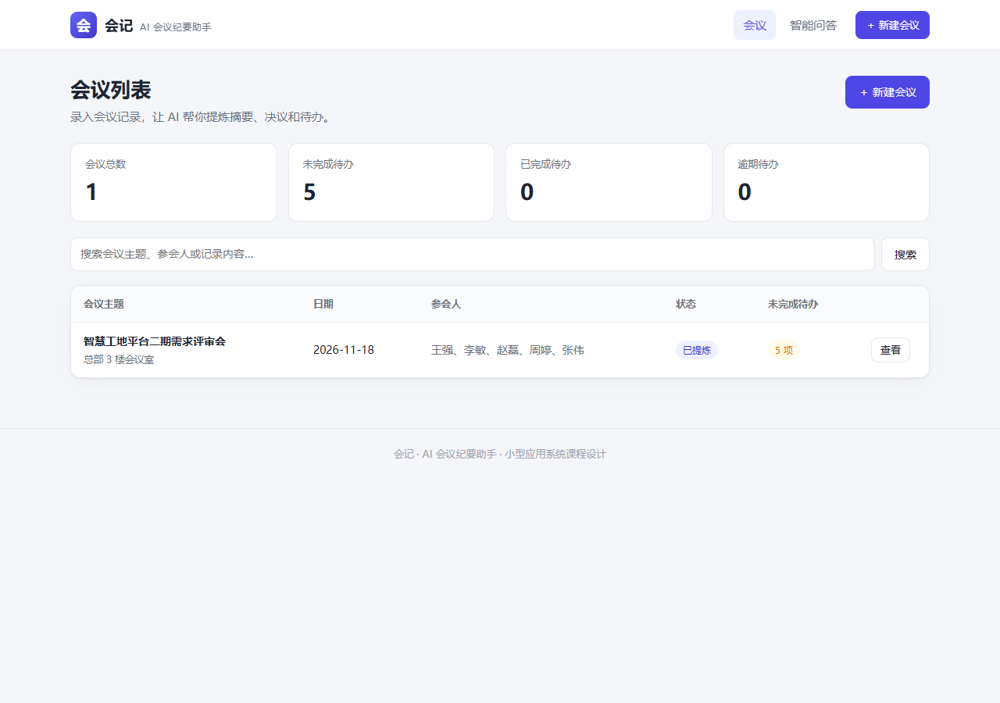
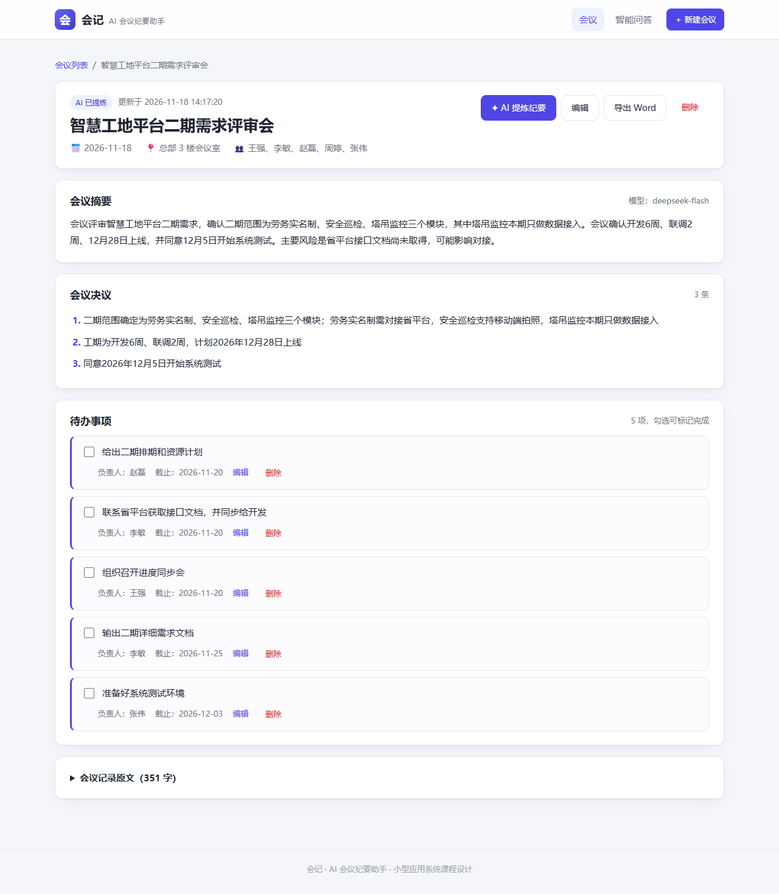
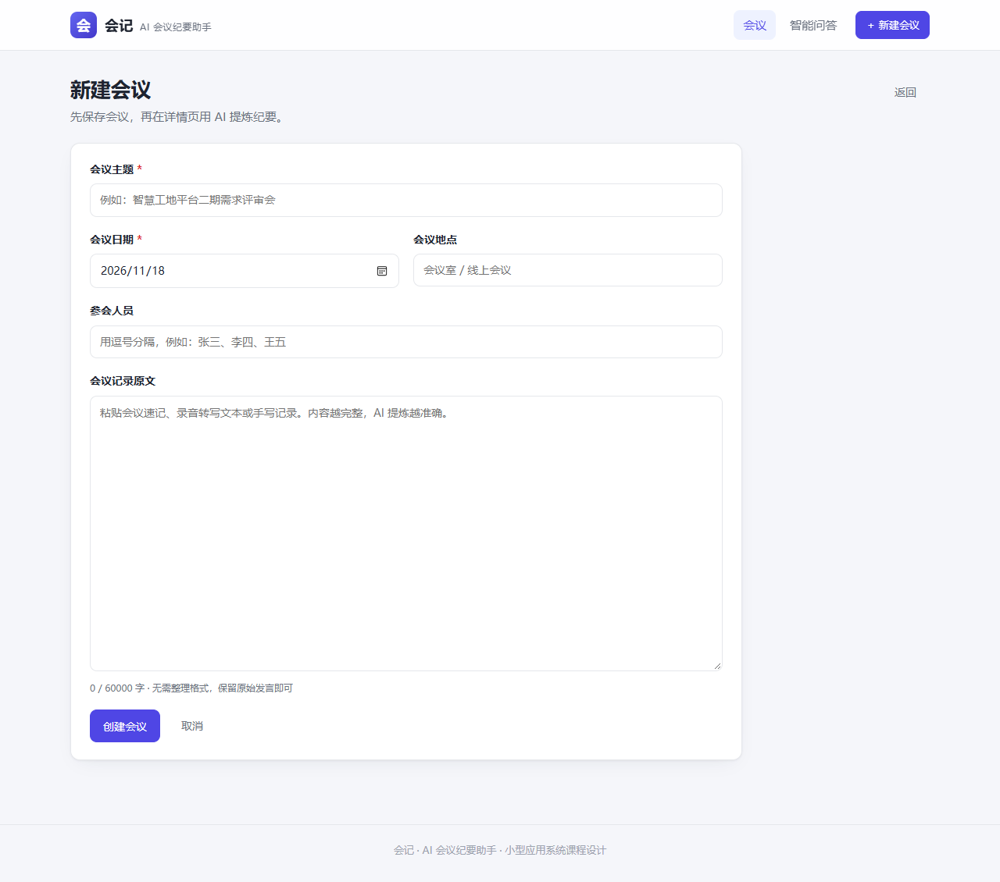
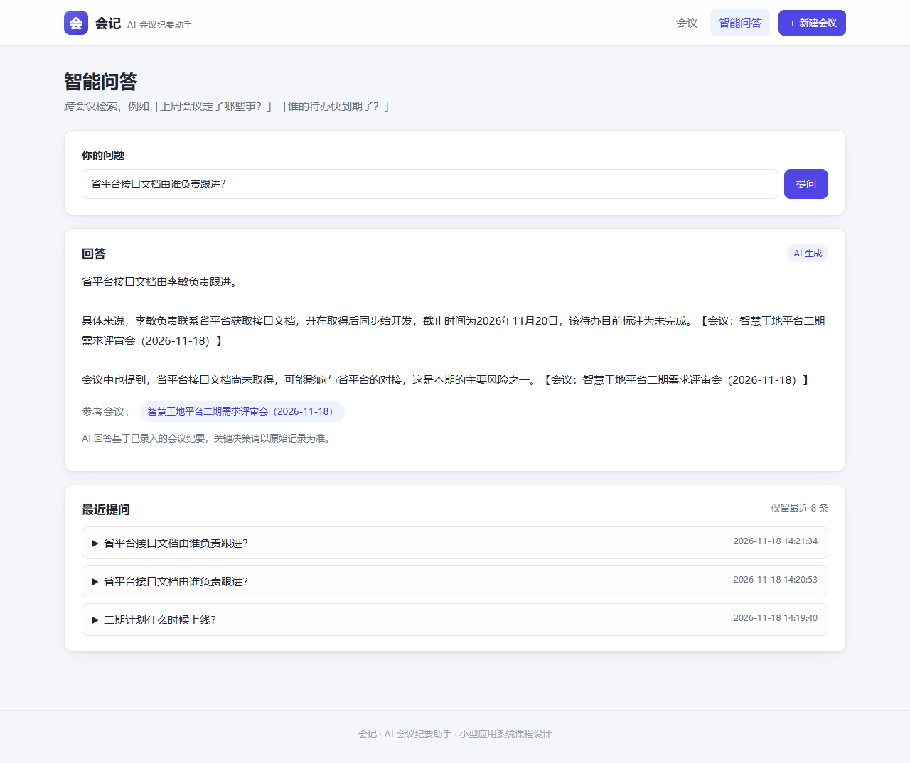

# 会记 · AI 会议纪要助手

「会记」是一个基于大语言模型的小型会议纪要管理系统。录入会议记录后，AI 自动提炼摘要、决议和待办，并支持跨会议智能问答与 Word 导出。

本项目是《人工智能应用》课程小型应用系统作业的完整实现，覆盖需求分析、系统设计、编码实现、测试与过程评价全流程。

## 界面预览

| 会议列表 | 会议详情 |
| --- | --- |
|  |  |

| 新建会议 | 智能问答 |
| --- | --- |
|  |  |

## 功能

- **会议管理**：新建、编辑、删除、搜索会议，保存主题、日期、参会人、地点与记录原文
- **AI 纪要提炼**：调用 DeepSeek 从原始记录中生成摘要、决议与待办（负责人、截止日期），重新提炼时保留已勾选待办的状态
- **待办跟踪**：勾选完成、编辑、删除，自动标记逾期
- **智能问答**：关键词检索相关会议后交由 AI 回答，并标注来源会议
- **Word 导出**：将纪要导出为排版好的 `.docx`，包含摘要、决议、待办表格与记录原文
- **问答历史**：保留最近 8 条提问记录

## 技术栈

| 层 | 技术 |
| --- | --- |
| 后端 | Python 3.14 + Flask 3.1 |
| 数据库 | SQLite（标准库 sqlite3） |
| AI | DeepSeek API（OpenAI 兼容接口），模型默认 `deepseek-flash` |
| 前端 | Jinja2 模板 + 原生 HTML/CSS/JavaScript |
| 文档导出 | python-docx |
| 测试 | pytest + Flask 测试客户端 |

## 快速开始

```bash
# 1. 安装依赖
python -m pip install -r requirements.txt

# 2. 配置 API Key
copy .env.example .env        # Windows
# 编辑 .env，填入 DEEPSEEK_API_KEY

# 3. 启动
python app.py
# 浏览器访问 http://127.0.0.1:5000
```

没有 API Key 时，会议增删改查、搜索、导出仍可使用；AI 提炼与问答按钮会提示未配置。

写入一条演示会议（不需要 API Key）：

```bash
python scripts/seed_demo.py
```

## 项目文档

| 文档 | 说明 |
| --- | --- |
| [需求规格说明书](docs/01-需求规格说明书.md) | 功能需求、非功能需求、用例与验收标准 |
| [系统分析说明书](docs/02-系统分析说明书.md) | 可行性、业务流程、用例、ER 图与数据流 |
| [系统设计说明书](docs/03-系统设计说明书.md) | 架构、模块、数据库、接口、AI 交互与界面 |
| [测试报告](docs/04-测试报告.md) | 测试策略、32 个用例、覆盖率与真实联调记录 |
| [开发过程分析与评价报告](docs/05-开发过程分析与评价报告.md) | 全过程回顾、AI 应用评价与经验总结 |
| [报告 Word 版](docs/05-开发过程分析与评价报告.docx) | 可直接提交的排版版本（封面信息待填写） |

## 配置项

| 环境变量 | 默认值 | 说明 |
| --- | --- | --- |
| `DEEPSEEK_API_KEY` | 空 | 必填才能使用 AI 功能 |
| `DEEPSEEK_BASE_URL` | `https://api.deepseek.com` | OpenAI 兼容接口地址 |
| `DEEPSEEK_MODEL` | `deepseek-flash` | 模型 ID，可按账号可用模型调整 |
| `SECRET_KEY` | `dev-secret-change-me` | Flask 会话密钥 |
| `DATABASE_PATH` | `instance/meetings.db` | SQLite 文件路径 |
| `AI_TIMEOUT` | `60` | AI 请求超时秒数 |
| `AI_MAX_TRANSCRIPT_CHARS` | `60000` | 送入模型的最大记录长度 |

## 测试

```bash
python -m pytest -v
```

测试用假 AI 服务注入，不消耗 API 额度，覆盖会议 CRUD、参数校验、纪要提炼、待办状态保持、问答、Word 导出与异常处理。

## 目录结构

```
ai-meeting-minutes/
├── app.py                 # 应用工厂与入口
├── config.py              # 配置与 .env 加载
├── db.py                  # SQLite 访问层
├── schema.sql             # 表结构
├── routes.py              # 路由与业务逻辑
├── ai_service.py          # DeepSeek 封装、JSON 解析、会议检索
├── docx_export.py         # Word 导出
├── templates/             # Jinja2 页面
├── static/                # CSS 与 JavaScript
├── tests/                 # pytest 测试
├── docs/                  # 需求、设计、测试与评价报告
└── requirements.txt
```

## 安全说明

- 本系统定位为**本地单用户工具**，默认只监听 `127.0.0.1`，未实现登录与权限控制，请勿直接部署到公网。
- API Key 仅保存在服务端 `.env`，不会发送到浏览器。
- 会议原文会发送给 DeepSeek 用于提炼，涉及敏感内容时请先脱敏。
