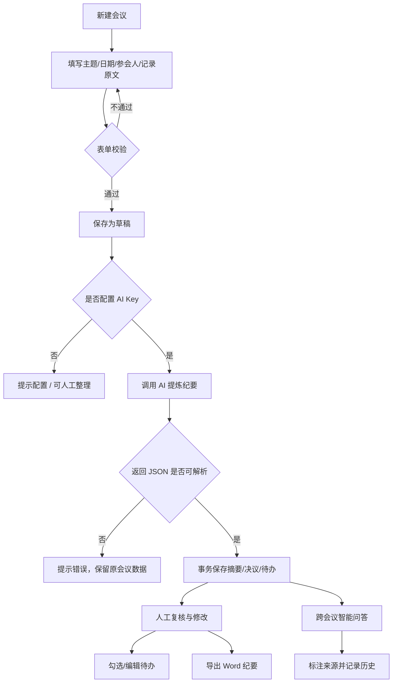
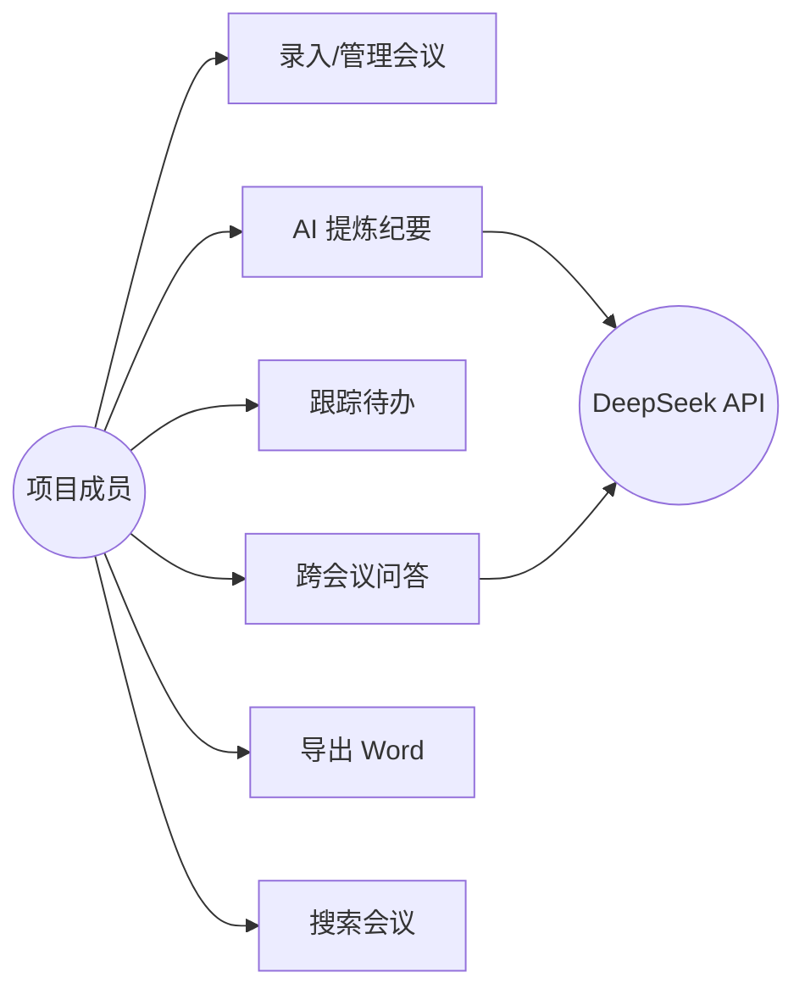
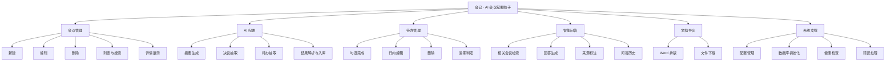
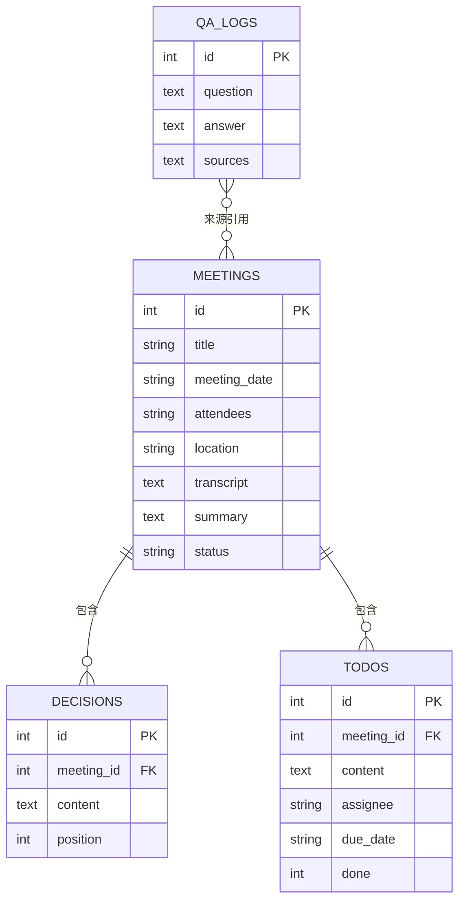
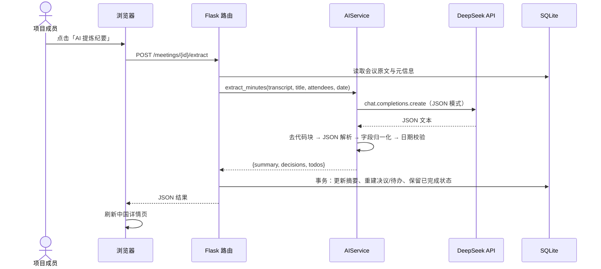
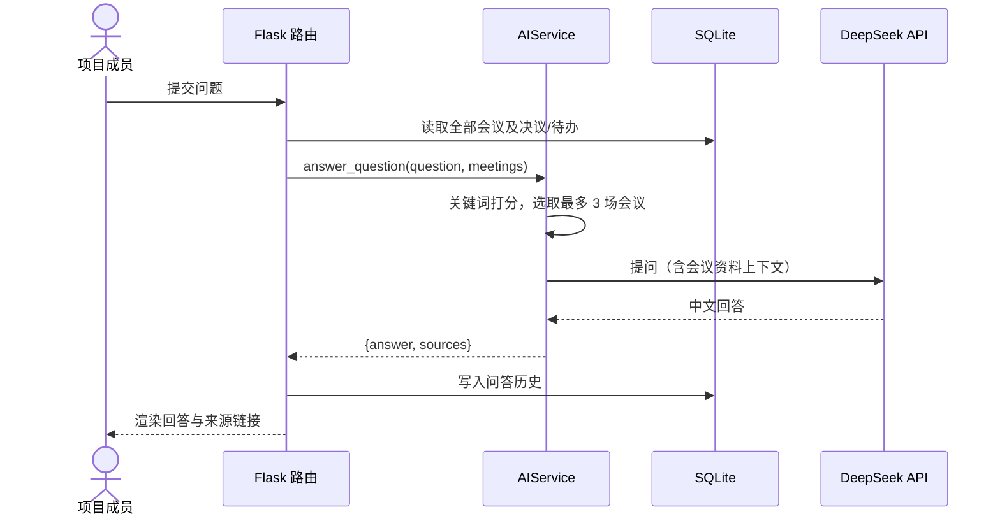
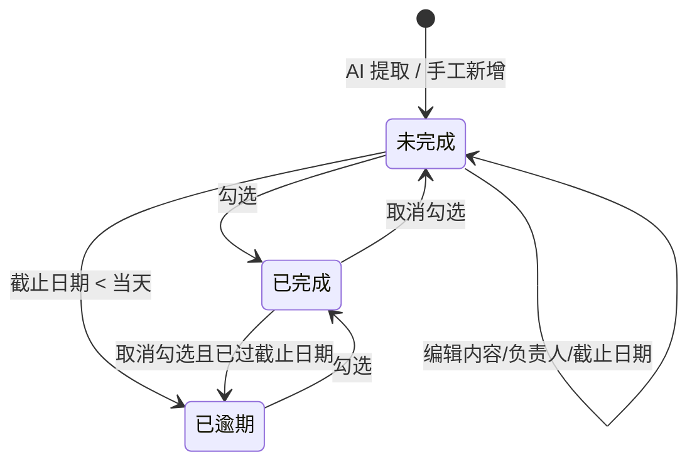
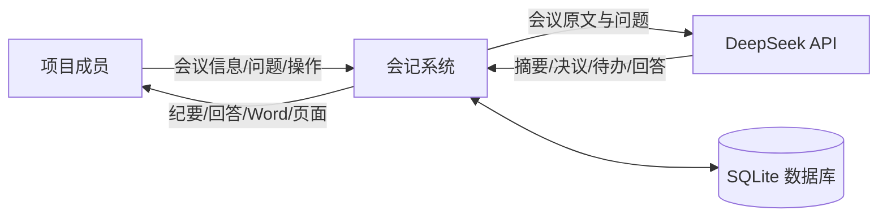

# 系统分析说明书

> 项目：会记 · AI 会议纪要助手　版本：v0.1.0　日期：2026-11-18

## 1 可行性分析

### 1.1 技术可行性

| 技术点 | 方案 | 成熟度与风险 |
| --- | --- | --- |
| Web 框架 | Flask 3.1 | 成熟稳定，学习成本低，适合小型系统 |
| 数据库 | SQLite | Python 标准库支持，零部署，满足单用户数据量 |
| 大模型 | DeepSeek API（OpenAI 兼容） | 提供 JSON 输出与长上下文，国内可直连；存在服务波动风险 |
| 文档导出 | python-docx | 成熟的 Word 生成库，支持中文字体与表格 |
| 前端 | Jinja2 + 原生 JS | 无需 Node.js 构建，部署简单 |
| 测试 | pytest + Flask test client | 可注入假 AI 服务，测试稳定、不消耗额度 |

系统使用的均为成熟技术，代码规模约 2600 行，单人借助 AI 可在短时间内完成，技术风险可控。主要不确定性来自模型输出的稳定性，已通过 JSON 模式、解析容错和人工复核设计降低风险。

### 1.2 经济可行性

- 软件全部开源，无授权费用；
- 运行在本机，无需云服务器；
- DeepSeek API 按量计费，单次会议提炼约数千 token，成本极低；
- 开发阶段使用假 AI 服务运行测试，避免测试消耗 API 额度。

### 1.3 操作可行性

系统为浏览器界面，全中文操作，核心流程只需「新建会议 → 粘贴记录 → 点击提炼」三步。目标用户无需安装客户端或了解 AI 技术。单用户本地运行，不涉及组织权限与流程改造。

### 1.4 进度可行性

功能范围限定为会议纪要闭环，不包含登录、语音转写、公网部署等扩展项。采用 AI 辅助编码与测试生成，可将开发周期压缩到单个工作日内，进度风险低。

## 2 业务流程分析

业务流程的核心是「AI 生成 + 人工复核」：AI 负责从非结构化文本中抽取信息，人负责判断决议是否准确、待办是否合理。系统保留原始记录与可编辑的待办，避免把模型输出当作最终事实。

## 3 用户角色与用例

系统只有一类参与者：**项目成员**（单用户）。外部系统参与者为 **DeepSeek 模型服务**。

| 用例 | 触发 | 主要产出 |
| --- | --- | --- |
| UC1 管理会议 | 用户新建/编辑/删除 | 会议记录 |
| UC2 提炼纪要 | 用户点击「AI 提炼纪要」 | 摘要、决议、待办 |
| UC3 跟踪待办 | 用户勾选/编辑/删除 | 待办状态变化 |
| UC4 跨会议问答 | 用户提交问题 | 带来源的回答 |
| UC5 导出 Word | 用户点击「导出 Word」 | .docx 文件 |
| UC6 搜索会议 | 用户输入关键词 | 过滤后的会议列表 |

## 4 功能结构分析

## 5 领域模型分析

说明：`qa_logs.sources` 以 JSON 数组保存来源会议的 id、标题与日期，逻辑上引用 `meetings`，但不建立外键，避免会议删除后历史问答失效。

## 6 关键流程分析

### 6.1 AI 纪要提炼时序

关键分析点：

- **原子性**：删除旧决议/待办与写入新数据必须在同一事务中，避免中途失败导致数据不一致；
- **状态保持**：以 `content` 为业务键，重新提炼时匹配旧待办并保留 `done`；
- **可恢复性**：模型调用在事务之前完成，失败时数据库不变。

### 6.2 智能问答时序

检索策略：将问题与会议标题、摘要、决议、待办、原文分别做中文二元字组和英文词切分，按标题权重 4、摘要 3、决议/待办 2、原文 1 计算重合度；全部为 0 时回退到最近 3 场会议。该策略无需向量数据库，适合小型本地系统。

### 6.3 待办状态分析

「逾期」不是持久化状态，而是由 `done = 0 AND due_date < today` 实时计算，避免定时任务与状态漂移。

## 7 数据流分析

### 7.1 顶层数据流

### 7.2 主要数据流说明

| 编号 | 输入 | 处理 | 输出 |
| --- | --- | --- | --- |
| DF-01 | 会议表单 | 校验、插入 | 会议记录、详情页 |
| DF-02 | 会议原文 | 提示词组装、模型调用、JSON 解析 | 摘要/决议/待办 |
| DF-03 | 待办操作 | 状态更新、逾期计算 | 更新后的待办列表 |
| DF-04 | 自然语言问题 | 关键词检索、模型问答 | 回答、来源、历史记录 |
| DF-05 | 会议 ID | 查询、Word 排版 | .docx 附件 |

## 8 非功能需求分析

| 需求 | 分析 | 设计对策 |
| --- | --- | --- |
| 性能 | 本地 SQLite 查询开销小；AI 是主要延迟来源 | 限制上下文长度；显示加载状态；设置 60～90 s 超时 |
| 可靠性 | 模型可能超时、返回非 JSON 或空内容 | 事务、解析容错、友好错误提示、数据不丢失 |
| 易用性 | 用户不熟悉 AI，需知道何时可用 | 未配置 Key 时禁用按钮并提示；危险操作二次确认 |
| 安全性 | 会议内容可能敏感；Key 不能泄露 | Key 存服务端 .env；.gitignore 排除；仅监听本机 |
| 可维护性 | 后续可能换模型或加功能 | 配置外置；AI 服务独立封装；分层与测试 |
| 可扩展性 | 未来可能多人使用或加语音 | 当前单用户；接口与数据层可替换为服务端数据库 |

## 9 分析结论

系统业务流程清晰，功能边界可控，技术方案成熟。核心难点不在 CRUD，而在 **AI 输出的结构化与可靠性**：需要通过 JSON 模式、解析容错、日期归一化、事务和人工复核共同保证。分析结果支持进入系统设计阶段。
