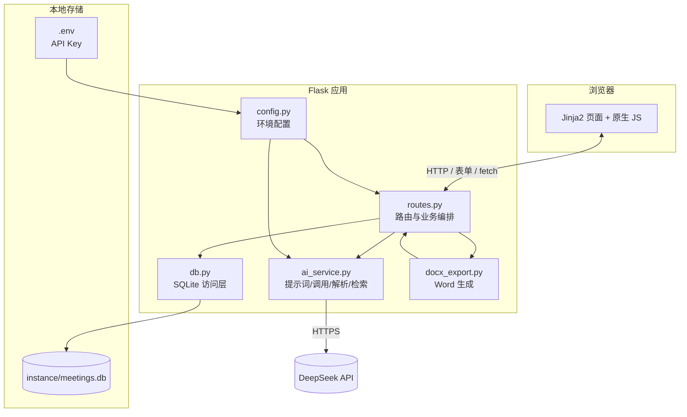
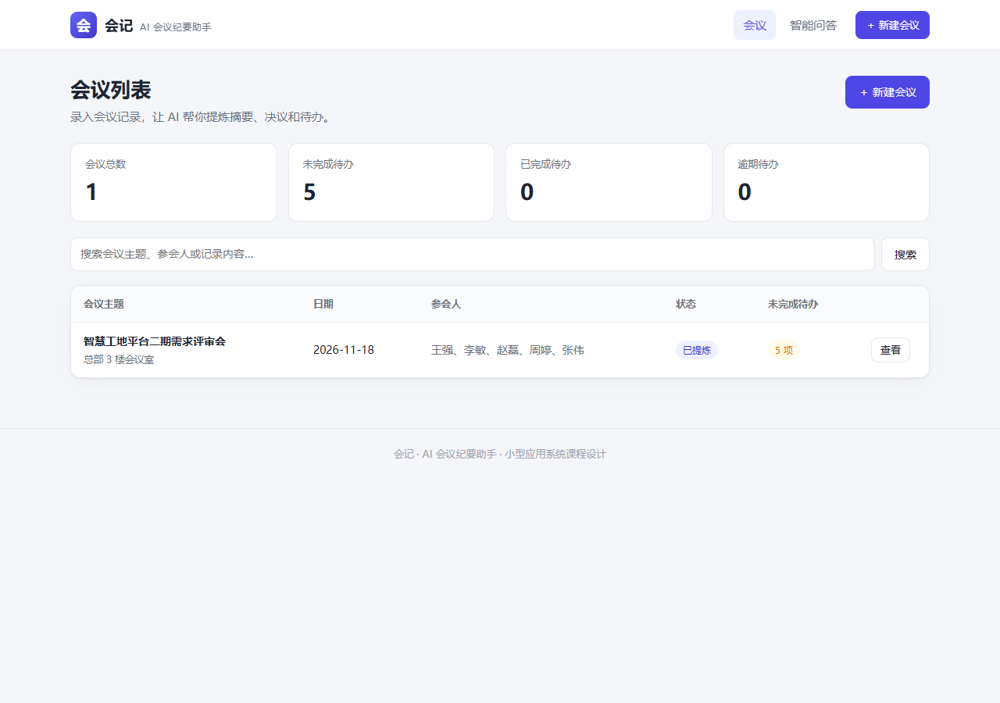
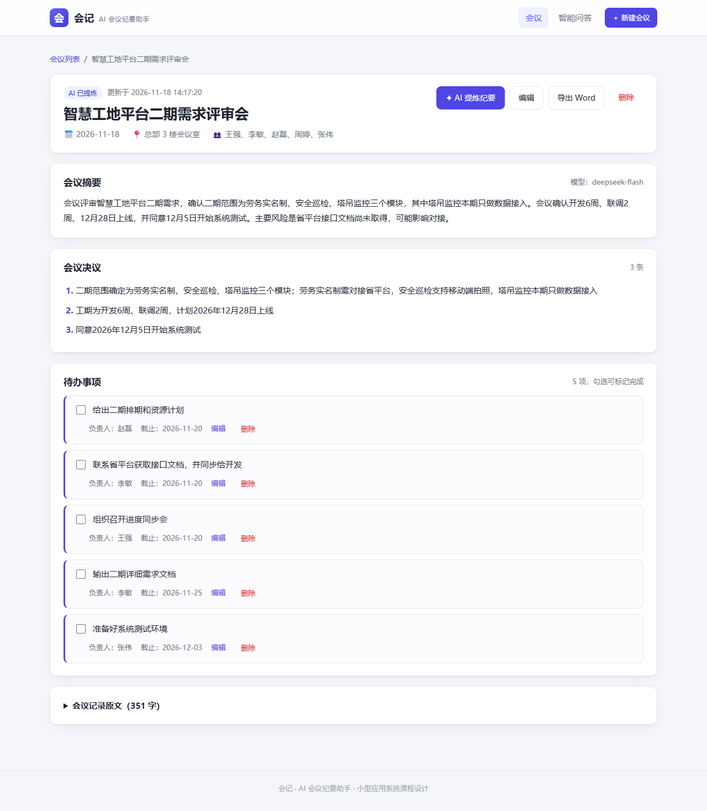
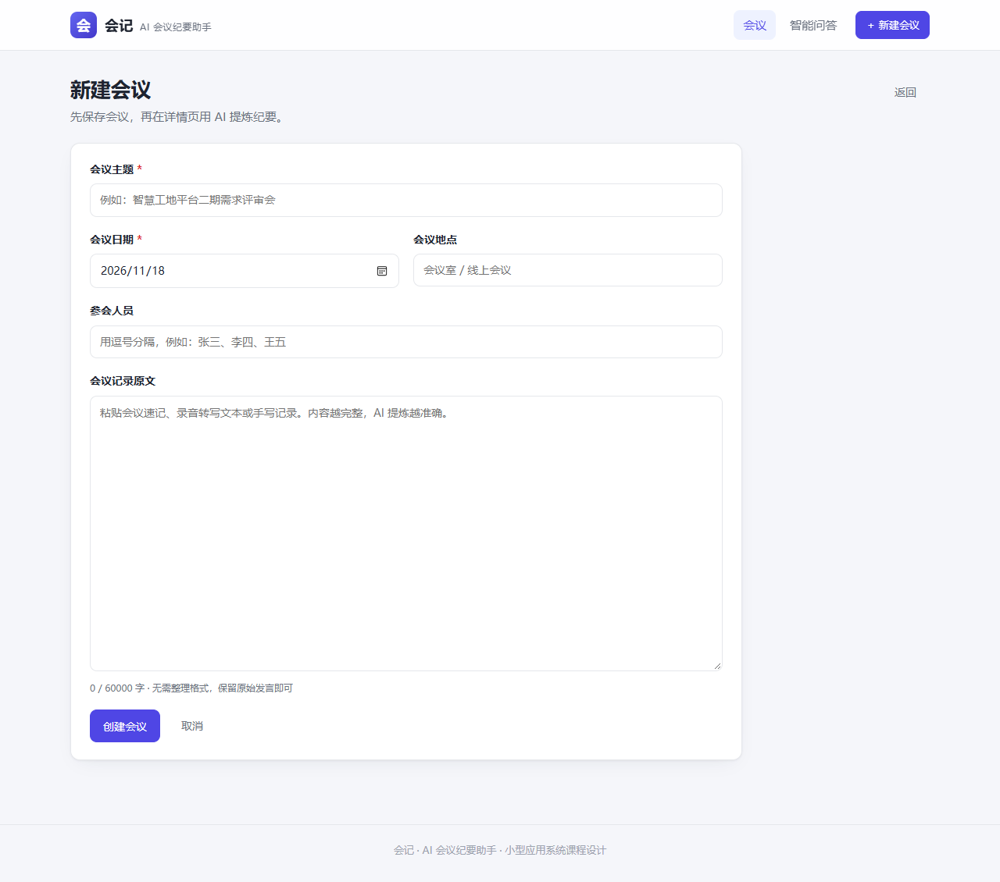
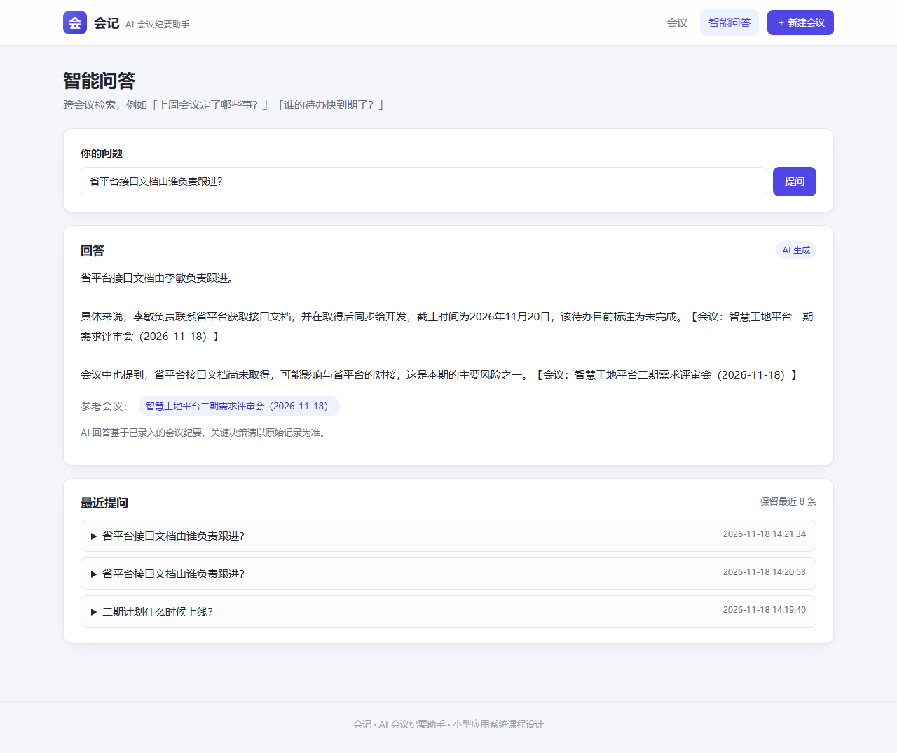

# 系统设计说明书

> 项目：会记 · AI 会议纪要助手　版本：v0.1.0　日期：2026-11-18

## 1 设计目标与原则

1. **小而完整**：覆盖会议纪要闭环，不引入登录、消息队列、向量数据库等超出课程范围的组件。
2. **AI 可替换**：模型调用封装在 `AIService` 中，通过环境变量配置 base_url、模型与超时，便于切换供应商。
3. **失败不丢数据**：模型调用与数据库写入分离，纪要写入使用事务；AI 异常只影响本次操作。
4. **本地优先**：SQLite 单文件存储，应用默认只监听 `127.0.0.1`，无需服务器。
5. **可验证**：核心逻辑与 AI 解耦，测试中注入假 AI 服务，保证测试可重复、不消耗额度。
6. **人工复核**：AI 生成结果可编辑，界面明确标注「AI 生成」，不把模型输出当作最终事实。

## 2 总体架构



系统采用经典的分层结构：

| 层 | 文件 | 职责 | 不做什么 |
| --- | --- | --- | --- |
| 表现层 | `templates/`、`static/` | 页面渲染、交互、加载状态 | 不直接访问数据库 |
| 控制层 | `routes.py` | 参数校验、业务编排、事务 | 不拼接 AI 提示词细节 |
| 服务层 | `ai_service.py`、`docx_export.py` | 模型调用、JSON 解析、检索、文档排版 | 不感知 HTTP |
| 数据层 | `db.py`、`schema.sql` | 连接管理、查询、建表 | 不包含业务判断 |
| 配置层 | `config.py`、`.env` | 密钥、模型、超时、路径 | 不提交真实密钥 |

## 3 技术选型

| 需求 | 选择 | 理由 | 未选方案及原因 |
| --- | --- | --- | --- |
| Web 框架 | Flask 3.1 | 轻量、路由直观、模板内置 | Django 过重；FastAPI 需要额外前端/模板方案 |
| 数据库 | SQLite | 单文件、零配置、标准库支持 | MySQL/PostgreSQL 需要独立服务 |
| 模型接口 | DeepSeek + openai SDK | OpenAI 兼容、国内可直连、成本低 | 直接使用 HTTP 也可，但 SDK 负责重试与异常 |
| 结构化输出 | JSON mode + 容错解析 | 降低格式错误率 | 仅靠提示词约束不稳定 |
| 前端 | Jinja2 + 原生 JS | 无构建链、部署简单 | Vue/React 增加复杂度 |
| 文档导出 | python-docx | 支持中文字体、表格、段落 | 手工生成 OOXML 成本高 |
| 测试 | pytest + test client | 与 Flask 集成好、可注入假服务 | unittest 样板代码更多 |

## 4 模块设计

### 4.1 模块清单

| 模块 | 主要函数/类 | 说明 |
| --- | --- | --- |
| `app.py` | `create_app()` | 应用工厂：加载配置、初始化数据库、注册蓝图与错误页 |
| `config.py` | `Config`、`_load_dotenv()` | 读取环境变量与 .env，提供默认值 |
| `db.py` | `get_db()`、`query()`、`execute()`、`init_db()` | 连接、查询、事务提交、建表 |
| `ai_service.py` | `AIService`、`parse_minutes_json()`、`select_relevant_meetings()` | 纪要提炼、问答、JSON 解析、检索 |
| `routes.py` | 蓝图 `main` | 全部 HTTP 路由与业务逻辑 |
| `docx_export.py` | `build_meeting_docx()`、`build_filename()` | 生成 Word 内存文件与安全文件名 |
| `templates/` | 6 个模板 | 基础布局、列表、表单、详情、问答、404 |
| `static/` | `style.css`、`app.js` | 设计系统与交互脚本 |

### 4.2 应用工厂

`create_app(test_config)` 支持测试注入：

```python
app = Flask(__name__, instance_relative_config=True)
app.config.from_object(Config)
if test_config:
    app.config.update(test_config)
db.init_app(app)                       # 建表 + 连接生命周期
app.extensions["ai_service"] = AIService(app.config)
app.register_blueprint(main)
```

测试用 `test_config` 指定临时数据库，并把 `app.extensions["ai_service"]` 替换为假服务。这一设计让路由测试与真实 API 完全解耦。

### 4.3 数据访问层

- 每个请求通过 Flask `g` 复用连接，请求结束自动关闭；
- 连接启用 `PRAGMA foreign_keys = ON`，保证级联删除生效；
- `query()` 返回 `sqlite3.Row`，模板可通过 `row['field']` 访问；
- 建表脚本使用 `IF NOT EXISTS`，启动时自动执行，重复启动安全。

### 4.4 AI 服务

`AIService` 的公开能力：

| 方法 | 输入 | 输出 | 异常 |
| --- | --- | --- | --- |
| `available` | — | Key 是否配置 | — |
| `extract_minutes()` | 原文、标题、参会人、日期 | `{summary, decisions, todos}` | `AIServiceError` |
| `answer_question()` | 问题、会议列表 | `{answer, sources}` | `AIServiceError` |

内部流程：准备提示词 → 调用 OpenAI 兼容接口 → 提取 `choices[0].message.content` → 解析 JSON → 归一化字段 → 返回。异常统一转换为中文可读信息，例如 Key 无效、超时、限流、余额不足。

### 4.5 路由层

路由层负责：

- 表单读取与校验（主题、日期必填，日期格式合法）；
- 会议与待办的 CRUD；
- 调用 AI 服务并把异常转换为 502 JSON 或页面提示；
- 事务写入纪要；
- 导出时把 `sqlite3.Row` 转为普通字典；
- 问答历史保存与来源组装。

### 4.6 前端交互

- 「AI 提炼纪要」使用 `fetch` 异步 POST，按钮进入禁用与加载文案状态，成功后刷新页面；
- 待办勾选使用 `fetch` 更新，失败则回滚复选框；
- 危险操作通过 `data-confirm` 统一二次确认；
- 输入框实时统计字数，帮助用户控制 60000 字上限；
- 无外部 CDN 依赖，离线也能正常渲染。

## 5 数据库设计

### 5.1 表结构

**meetings（会议）**

| 字段 | 类型 | 约束 | 说明 |
| --- | --- | --- | --- |
| id | INTEGER | PK AUTOINCREMENT | 主键 |
| title | TEXT | NOT NULL | 主题 |
| meeting_date | TEXT | NOT NULL | ISO 日期 `YYYY-MM-DD` |
| attendees | TEXT | NOT NULL DEFAULT '' | 参会人，逗号分隔 |
| location | TEXT | NOT NULL DEFAULT '' | 地点 |
| transcript | TEXT | NOT NULL DEFAULT '' | 记录原文 |
| summary | TEXT | NOT NULL DEFAULT '' | AI 摘要 |
| status | TEXT | NOT NULL DEFAULT 'draft' | `draft` / `processed` |
| created_at | TEXT | DEFAULT 本地时间 | 创建时间 |
| updated_at | TEXT | DEFAULT 本地时间 | 更新时间 |

**decisions（决议）**

| 字段 | 类型 | 约束 | 说明 |
| --- | --- | --- | --- |
| id | INTEGER | PK | 主键 |
| meeting_id | INTEGER | FK → meetings.id, ON DELETE CASCADE | 所属会议 |
| content | TEXT | NOT NULL | 决议内容 |
| position | INTEGER | NOT NULL DEFAULT 0 | 展示顺序 |

**todos（待办）**

| 字段 | 类型 | 约束 | 说明 |
| --- | --- | --- | --- |
| id | INTEGER | PK | 主键 |
| meeting_id | INTEGER | FK → meetings.id, ON DELETE CASCADE | 所属会议 |
| content | TEXT | NOT NULL | 事项 |
| assignee | TEXT | NOT NULL DEFAULT '' | 负责人 |
| due_date | TEXT | NOT NULL DEFAULT '' | 截止日期，可为空串 |
| done | INTEGER | NOT NULL DEFAULT 0 | 0 未完成 / 1 已完成 |
| created_at | TEXT | DEFAULT 本地时间 | 创建时间 |

**qa_logs（问答记录）**

| 字段 | 类型 | 约束 | 说明 |
| --- | --- | --- | --- |
| id | INTEGER | PK | 主键 |
| question | TEXT | NOT NULL | 问题 |
| answer | TEXT | NOT NULL | 回答 |
| sources | TEXT | NOT NULL DEFAULT '' | 来源 JSON 数组 |
| created_at | TEXT | DEFAULT 本地时间 | 时间 |

### 5.2 索引

| 索引 | 目的 |
| --- | --- |
| `idx_meetings_date` | 列表按日期倒序 |
| `idx_decisions_meeting` | 按会议查决议 |
| `idx_todos_meeting` | 按会议查待办 |
| `idx_todos_done (done, due_date)` | 统计未完成与逾期待办 |

### 5.3 约束与设计取舍

- **不建立 qa_logs → meetings 外键**：历史问答在会议删除后仍应可查看，来源以 JSON 快照保存；
- **due_date 使用 TEXT**：ISO 日期字符串可直接比较与排序，避免 SQLite 日期类型的兼容问题；
- **逾期不落库**：由查询时计算，避免定时任务与状态漂移；
- **级联删除**：利用外键 + `PRAGMA foreign_keys=ON`，删除会议即清理子表。

## 6 接口设计

### 6.1 HTTP 接口

| 方法 | 路径 | 功能 | 成功响应 | 主要错误 |
| --- | --- | --- | --- | --- |
| GET | `/` | 会议列表与统计 | HTML | — |
| GET/POST | `/meetings/new` | 新建会议 | 302 → 详情 | 400 表单错误 |
| GET | `/meetings/<id>` | 会议详情 | HTML | 404 |
| GET/POST | `/meetings/<id>/edit` | 编辑会议 | 302 → 详情 | 400 / 404 |
| POST | `/meetings/<id>/delete` | 删除会议 | 302 → 列表 | 404 |
| POST | `/meetings/<id>/extract` | AI 提炼纪要 | JSON `{ok:true,...}` | 502 AI 失败 |
| POST | `/todos/<id>/toggle` | 切换完成状态 | JSON `{ok:true,done:bool}` | 404 |
| POST | `/todos/<id>/edit` | 编辑待办 | 302 → 详情 | 400 日期非法 |
| POST | `/todos/<id>/delete` | 删除待办 | 302 → 详情 | 404 |
| GET | `/meetings/<id>/export` | 导出 Word | docx 附件 | 404 |
| GET/POST | `/ask` | 智能问答 | HTML | 502 AI 失败 |
| GET | `/api/health` | 健康检查 | JSON | — |

### 6.2 纪要提炼响应示例

```json
{
  "ok": true,
  "summary": "会议评审智慧工地平台二期需求……",
  "decisions": ["二期范围确定为……", "工期为……"],
  "todos": [
    {"content": "输出二期详细需求文档", "assignee": "李敏", "due_date": "2026-11-25"}
  ]
}
```

### 6.3 错误响应示例

```json
{"ok": false, "error": "AI 服务响应超时，请稍后重试或缩短会议记录"}
```

### 6.4 AI 输出 JSON 契约

```json
{
  "summary": "string，≤120 字",
  "decisions": ["string"],
  "todos": [
    {
      "content": "string，必填",
      "assignee": "string，未知则为空串",
      "due_date": "YYYY-MM-DD，未知则为空串"
    }
  ]
}
```

## 7 AI 交互设计

### 7.1 系统提示词设计

**纪要提炼提示词要点：**

1. 只依据原文，不编造；
2. 只输出合法 JSON，不输出代码块或解释；
3. 固定 JSON 结构；
4. 普通讨论不得写成决议；
5. 相对日期按会议日期换算；
6. 待办应具体可执行。

**问答提示词要点：**

1. 只使用提供的会议资料；
2. 资料不足时明确说明，不编造；
3. 中文回答，纯文本分点，不使用 Markdown 标记；
4. 关键结论后用【会议：标题（日期）】标注来源。

### 7.2 结构化输出与解析

调用时设置 `response_format={"type": "json_object"}`。若模型不支持该参数，捕获异常后自动去掉参数重试一次。解析容错链：

```text
原始文本
  → 去除 ```json 代码块围栏
  → 直接 json.loads
  → 失败则截取第一个 { 到最后一个 } 再解析
  → 字段归一化（类型、去重、空值、日期格式）
  → 三部分全空则判定为无效输出
```

日期归一化支持 `2026-12-01`、`2026/12/1`、`2026年12月1日`；`下周三`、`待定` 等无法解析的值留空，由人工补充。

### 7.3 相关会议检索

由于数据量小，未引入向量数据库。检索使用字符二元组与英文词切分：

```
score(m) = 4·|Q∩标题| + 3·|Q∩摘要| + 2·|Q∩决议| + 2·|Q∩待办| + 1·|Q∩原文前8000字|
```

按分数降序取前 3 场；若全部为 0，则回退到最近 3 场。该算法无额外依赖、可解释、可单元测试，缺点是语义泛化能力弱于向量检索。

### 7.4 上下文长度控制

| 控制点 | 策略 |
| --- | --- |
| 原文入库 | 表单限制 60000 字 |
| 提炼输入 | 超过 `AI_MAX_TRANSCRIPT_CHARS`（默认 60000）截断并标注 |
| 问答上下文 | 每场会议原文仅取前 3000 字，最多 3 场 |
| 请求体 | Flask `MAX_CONTENT_LENGTH = 2 MB` |

### 7.5 异常处理

| 异常 | 用户提示 | 数据处理 |
| --- | --- | --- |
| 未配置 Key | 按钮禁用 + 配置说明 | 基础功能不受影响 |
| 401 | 「API Key 无效或已过期」 | 不写库 |
| 超时 | 「响应超时，请稍后重试或缩短记录」 | 不写库 |
| 429 / 余额不足 | 对应中文提示 | 不写库 |
| 返回非 JSON | 「AI 返回内容不是有效 JSON，请重试」 | 不写库 |
| 三部分全空 | 「未能提炼出有效内容」 | 不写库 |

## 8 界面设计

### 8.1 页面结构

| 页面 | 主要内容 | 关键交互 |
| --- | --- | --- |
| 会议列表 | 统计卡片、搜索、会议表格 | 搜索、进入详情 |
| 新建/编辑会议 | 主题、日期、地点、参会人、原文 | 必填校验、字数统计 |
| 会议详情 | 摘要、决议、待办、原文、操作按钮 | AI 提炼、勾选、行内编辑、导出 |
| 智能问答 | 提问框、回答、来源、历史 | 提问、跳转来源会议 |
| 404 | 错误提示与返回入口 | 返回列表 |

### 8.2 界面截图

**会议列表**



**会议详情**



**新建会议**



**智能问答**



### 8.3 视觉规范

- 主色：靛蓝 `#4f46e5`，用于主按钮、链接、AI 标识；
- 状态色：绿色成功、红色逾期/删除、琥珀色警告；
- 圆角 12px 卡片 + 轻阴影，信息分组清晰；
- 字体使用系统中文字体栈（PingFang SC / 微软雅黑），不依赖网络字体；
- 响应式：760px 以下单列布局，统计卡片两列。

## 9 安全与异常设计

| 风险 | 对策 | 残余风险 |
| --- | --- | --- |
| API Key 泄露 | 仅存服务端 .env；.gitignore 排除；浏览器不接触 | 本机文件被读取 |
| 误部署公网 | 默认监听 127.0.0.1；README 明确说明 | 用户主动修改监听地址 |
| SQL 注入 | 全部使用参数化查询 | — |
| XSS | Jinja 自动转义；AI 内容以文本渲染 | 未实现富文本 |
| CSRF | 本地单用户，未实现 token | 恶意网页诱导本机请求 |
| 提示词注入 | 系统提示词约束；资料作为数据传入 | 模型仍可能被记录中的指令影响，需人工复核 |
| 敏感数据外传 | 仅发送提炼/问答所需文本 | 会议内容会被模型服务处理 |
| 误删除 | 二次确认；外键级联 | 无回收站 |

## 10 可扩展性设计

- **换模型**：修改 `DEEPSEEK_BASE_URL`、`DEEPSEEK_MODEL` 即可接入其他 OpenAI 兼容服务；
- **换数据库**：数据访问集中在 `db.py`，可替换为 PostgreSQL；
- **加语音转写**：在会议表单前增加音频上传与 ASR，转写文本复用现有流程；
- **多用户**：需增加用户表、登录态与数据隔离，当前未实现；
- **向量检索**：可将 `select_relevant_meetings()` 替换为 embedding + 向量库，接口保持不变。

## 11 设计结论

设计以「单用户、本地、可复核」为约束，采用 Flask + SQLite + DeepSeek 的轻量组合，通过应用工厂、AI 服务封装、事务写入与容错解析保证可测试性与可靠性。系统结构清晰，满足需求规格，具备继续扩展的空间。
